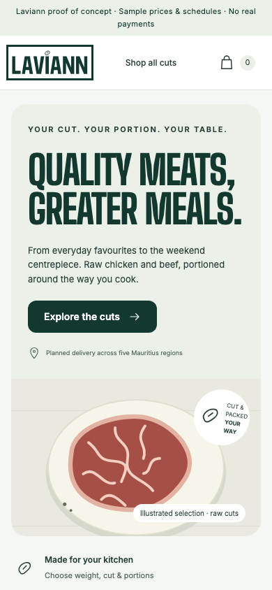
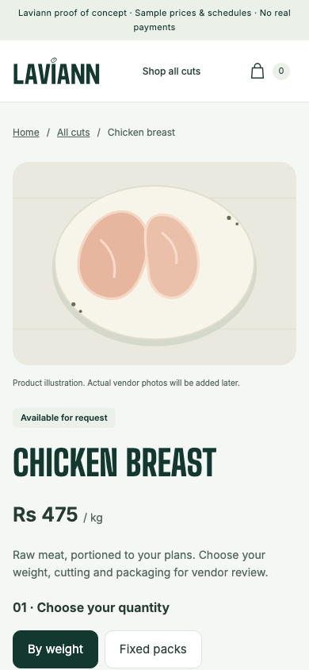
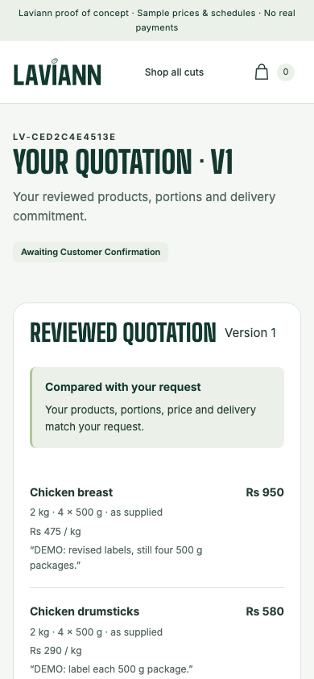
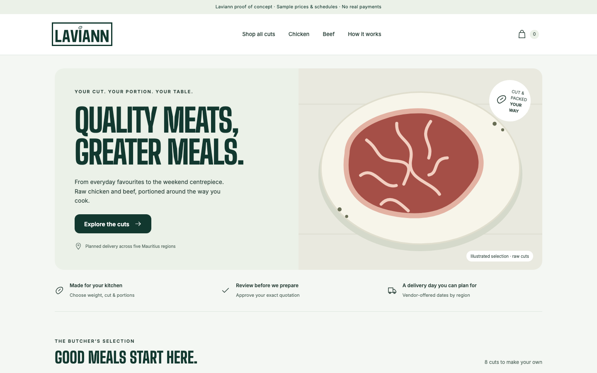

# Laviann customer storefront

The mobile-first guest storefront for Laviann, served at `http://localhost:3000`.
Customers browse raw chicken and beef, choose weight or fixed packs, request cuts and
portions, pick an offered delivery date for their region and submit an order request.
The vendor reviews it, and the customer approves the exact quotation through a private,
expiring link. No customer account or app-store install is needed.

## Preview

<table>
    <tr>
        <th>Mobile - home</th>
        <th>Mobile - choose cuts and portions</th>
        <th>Mobile - reviewed quotation</th>
    </tr>
    <tr>
        <td></td>
        <td></td>
        <td></td>
    </tr>
</table>

**Desktop - home**



Screenshots use demo prices, illustrations and fake customer details. Every customer
view is listed in [the verification record](../../docs/verification.md).

## Customer journey

| Route         | Purpose                                                         |
| ------------- | --------------------------------------------------------------- |
| `/`           | Home, featured cuts and how ordering works                      |
| `/shop`       | Full catalogue with search, category filter and sorting         |
| `/category/*` | Chicken or beef cuts                                            |
| `/product/*`  | Weight or fixed packs, cutting preference and portion packaging |
| `/cart`       | Review requested items; cart data is local and expires          |
| `/checkout`   | Contact details, region, offered delivery date and payment type |
| `/review`     | Final check before submitting the request                       |
| `/submitted`  | Confirmation with the private status link                       |
| `/quotation`  | Approve the vendor's exact quotation version                    |
| `/status`     | Order, preparation, delivery and payment progress               |

Prices, fees and availability are always recalculated on the server. Submitting a
request does not reserve stock; only approving the latest quotation does.

## Run it

From the repository root:

```sh
bun install --frozen-lockfile
bun run dev:customer
```

Copy `.env.example` to `.env.local` and follow [the setup guide](../../docs/setup.md)
to connect the local Supabase stack. With no Supabase URL, the storefront runs as a
clearly labelled read-only preview. Keep `SUPABASE_SERVICE_ROLE_KEY` and
`SERVER_TOKEN_SECRET` server-only, and never prefix them with `NEXT_PUBLIC_`.

See [the root README](../../README.md) for shared theme, assets and test commands, and
[AGENTS.md](AGENTS.md) for coding-agent rules specific to this app.
