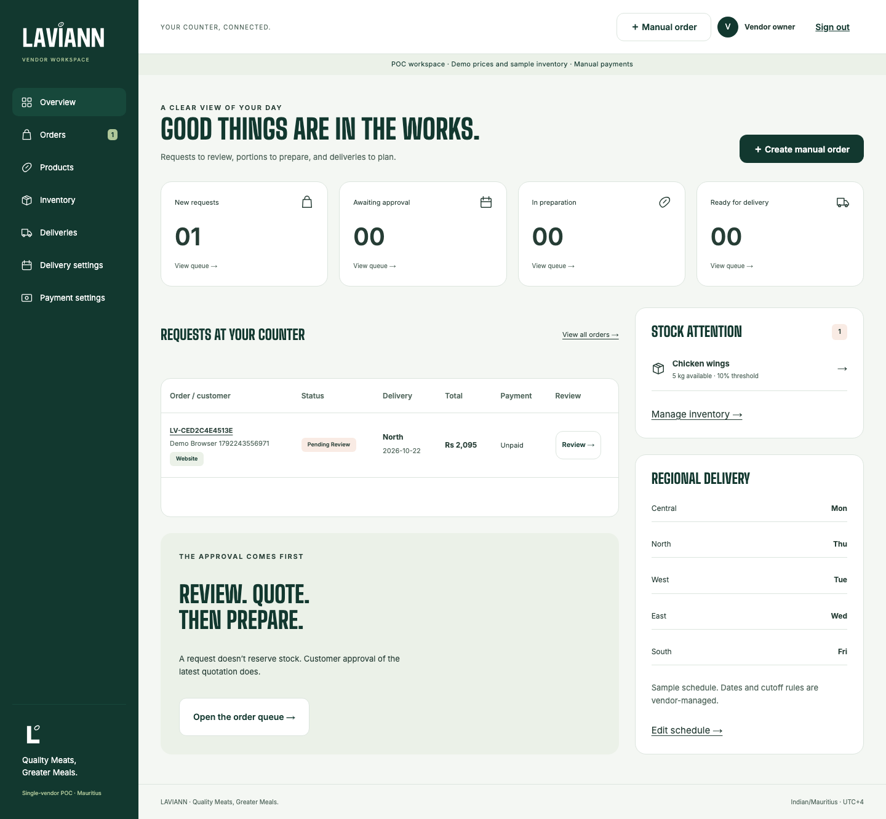
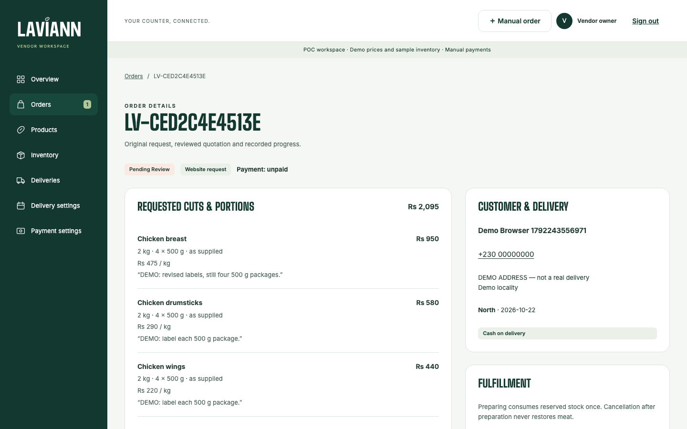
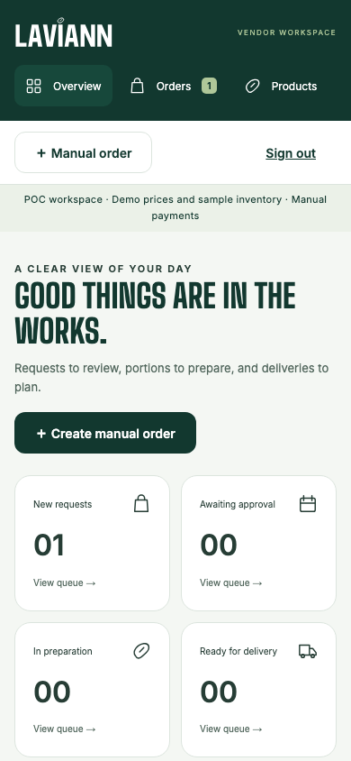
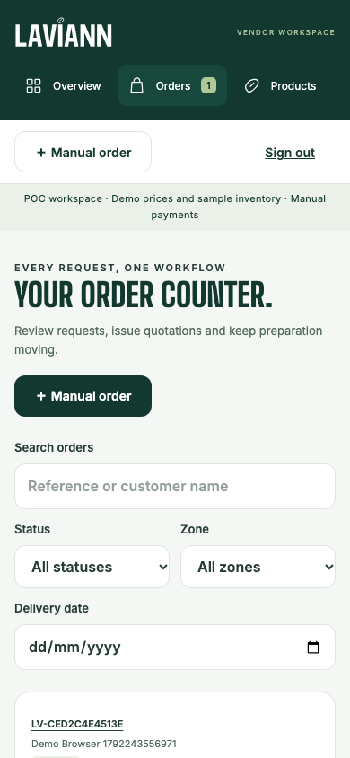

# Laviann vendor workspace

The authenticated dashboard for the single Laviann vendor, served at
`http://localhost:3001`. The owner reviews website and WhatsApp requests, issues and
revises quotations, manages products and stock, plans regional deliveries and records
payments manually. It replaces the handwritten order and photo with a structured order
and an explicit customer approval.

## Preview

**Desktop - overview**



**Desktop - order details and quotation**



<table>
    <tr>
        <th>Mobile - overview</th>
        <th>Mobile - order queue</th>
    </tr>
    <tr>
        <td></td>
        <td></td>
    </tr>
</table>

Screenshots use demo prices, sample inventory and fake customer details. Every vendor
view is listed in [the verification record](../../docs/verification.md).

## Workspace

| Route                | Purpose                                                         |
| -------------------- | --------------------------------------------------------------- |
| `/login`             | Owner sign-in; there is no public vendor registration           |
| `/`                  | Today's queues, stock alerts and regional delivery days         |
| `/orders`            | Search and filter orders by status, zone and delivery date      |
| `/orders/new`        | Record a WhatsApp or phone request as a normal order            |
| `/orders/[id]`       | Review, quote, revise, move through preparation, record payment |
| `/products`          | Catalogue, prices, cuts, portions and fixed packs               |
| `/inventory`         | On-hand, reserved and available stock with low-stock targets    |
| `/deliveries`        | Confirmed orders grouped by delivery date and region            |
| `/settings/delivery` | Zone fees, weekly delivery days, cutoffs and date exceptions    |
| `/settings/payments` | Cash, MCB Juice and bank-transfer instructions (manual only)    |

Customer approval reserves stock and moving to Preparing consumes it once. Payment is
always recorded manually and kept separate from order and delivery status.

## Run it

From the repository root:

```sh
bun install --frozen-lockfile
bun run dev:vendor
```

Copy `.env.example` to `.env.local` and follow [the setup guide](../../docs/setup.md)
to start the local Supabase stack and provision the demo owner. Supabase Auth signup is
disabled, so the owner is created explicitly. Without a Supabase URL, the workspace runs
as a clearly labelled read-only preview that cannot save changes.

See [the root README](../../README.md) for shared theme, assets and test commands, and
[AGENTS.md](AGENTS.md) for coding-agent rules specific to this app.
